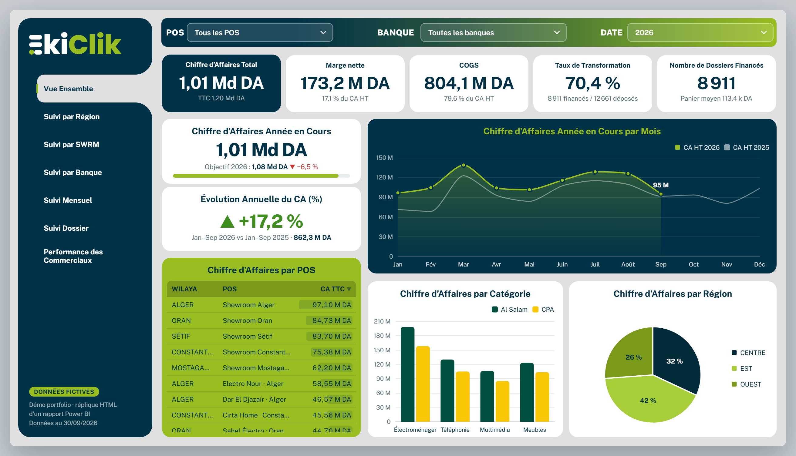
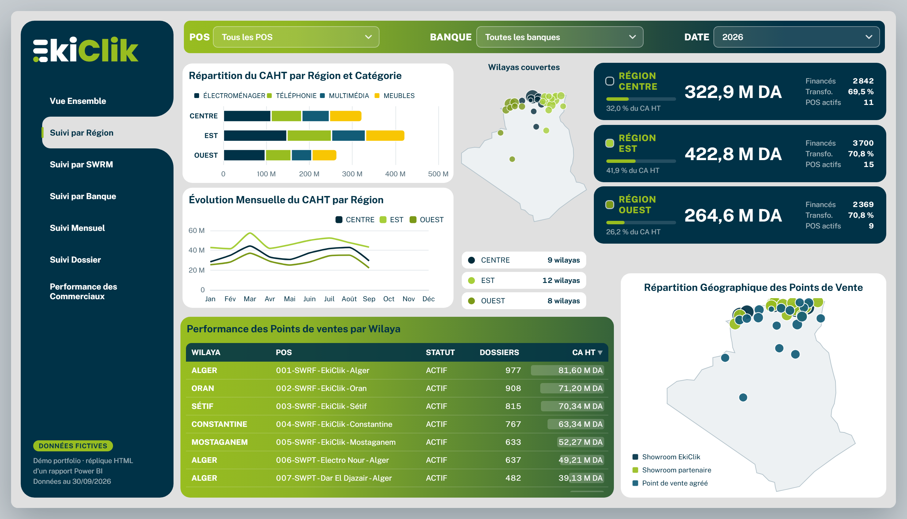
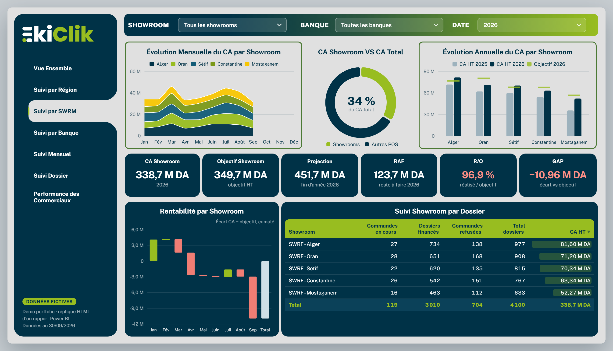
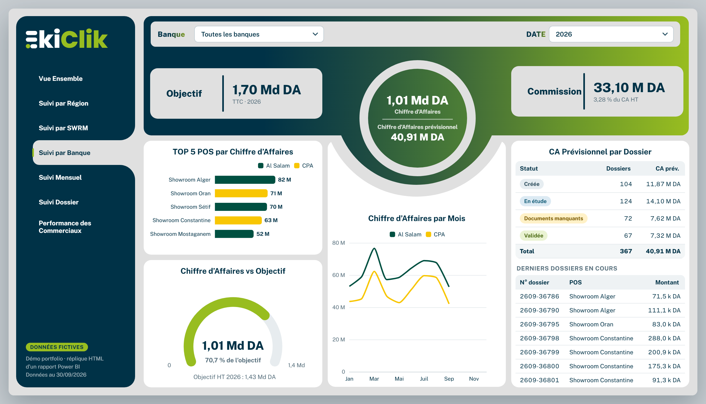
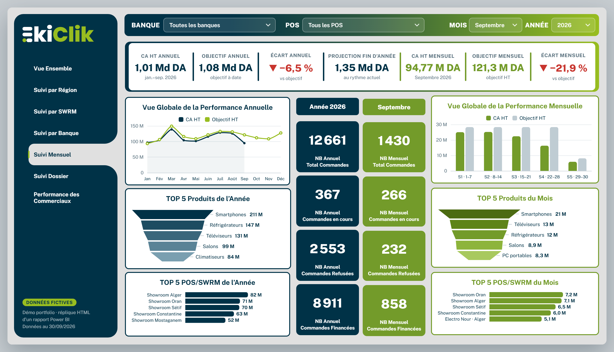
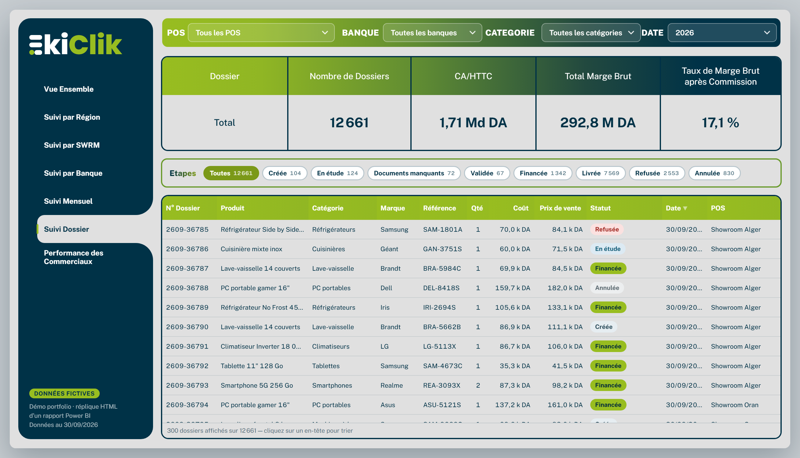
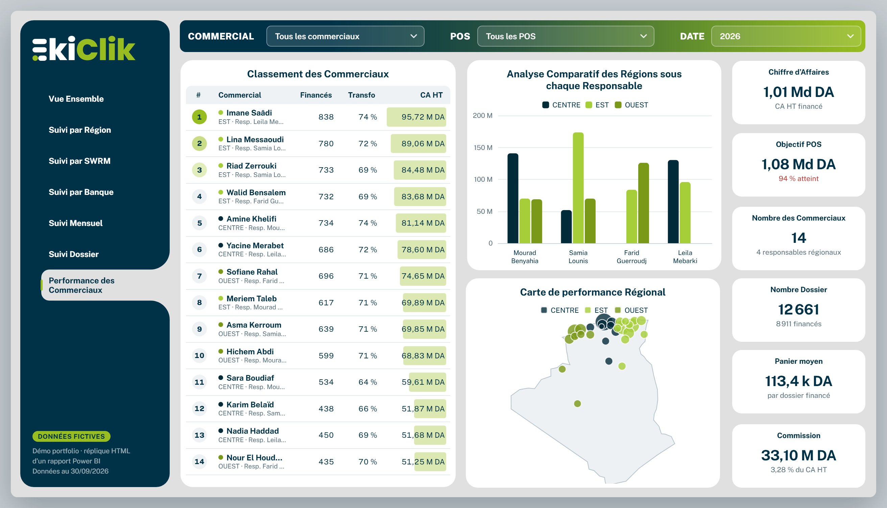

# EkiClik Sales Dashboard (Power BI → HTML)

An interactive web version of a multi-page **Power BI** report for tracking sales, consumer-credit files (*dossiers*), showrooms, partner banks and sales reps in a consumer-financing retail network in Algeria.

**▶ Live demo: https://dounia4112.github.io/Ekiclik-dashboard/**

> **All data is fictional.** It is generated in the browser from a fixed random seed (about 34,000 credit files, Jan 2024 – Sep 2026, 36 made-up points of sale in 30 wilayas). No real customer, employee or company figures are included.

## Pages

| Page | What it shows |
|---|---|
| **Accueil** | Landing page with navigation and headline figures |
| **Vue Ensemble** | Revenue (CA HT/TTC), net margin, COGS, conversion rate, financed files; year-to-date vs target; YoY change; revenue by month, POS, category and region |
| **Suivi par Région** | Revenue by region and category, monthly trend per region, wilaya map, point-of-sale performance table, geographic POS map |
| **Suivi par SWRM** | Showroom revenue trend, showroom share of total revenue, revenue vs target per showroom, projection, remaining-to-do (RAF), achievement rate (R/O), gap, waterfall of monthly gaps |
| **Suivi par Banque** | Target, revenue, pipeline revenue and commission per partner bank; top 5 POS; target gauge; monthly revenue by bank; pipeline files by status |
| **Suivi Mensuel** | Annual vs monthly performance side by side: revenue, target, gap, year-end projection, order counts (total / in progress / refused / financed), top 5 products and POS |
| **Suivi Dossier** | File-level table (product, category, brand, cost, price, status, date, POS) with status filter chips and margin summary |
| **Performance des Commerciaux** | Sales-rep ranking, regional comparison by manager, regional performance map, rep KPIs (average basket, commission…) |

## Features

- Filters on every page (POS, bank, date, showroom, category, sales rep, status) that recalculate all visuals
- Hover tooltips on every chart, sortable tables, shareable page links (e.g. `#banque`)
- Layout matches the original 1280×720 Power BI canvas, scales to any desktop screen and switches to a stacked layout on phones
- Report measures (CA HT/TTC, COGS, marge nette, taux de transformation, objectif, projection, RAF, R/O, GAP, commission, panier moyen) re-implemented in JavaScript

## Tech

Plain HTML, CSS and JavaScript in a single file ([`index.html`](index.html)), with [Apache ECharts 5.5](https://echarts.apache.org/) for charts and Google Fonts (Public Sans, Poppins). No build step: open `index.html` in a browser (an internet connection is needed to load ECharts and the fonts).

## Screenshots

| | |
|---|---|
|  |  |
|  |  |
|  |  |
